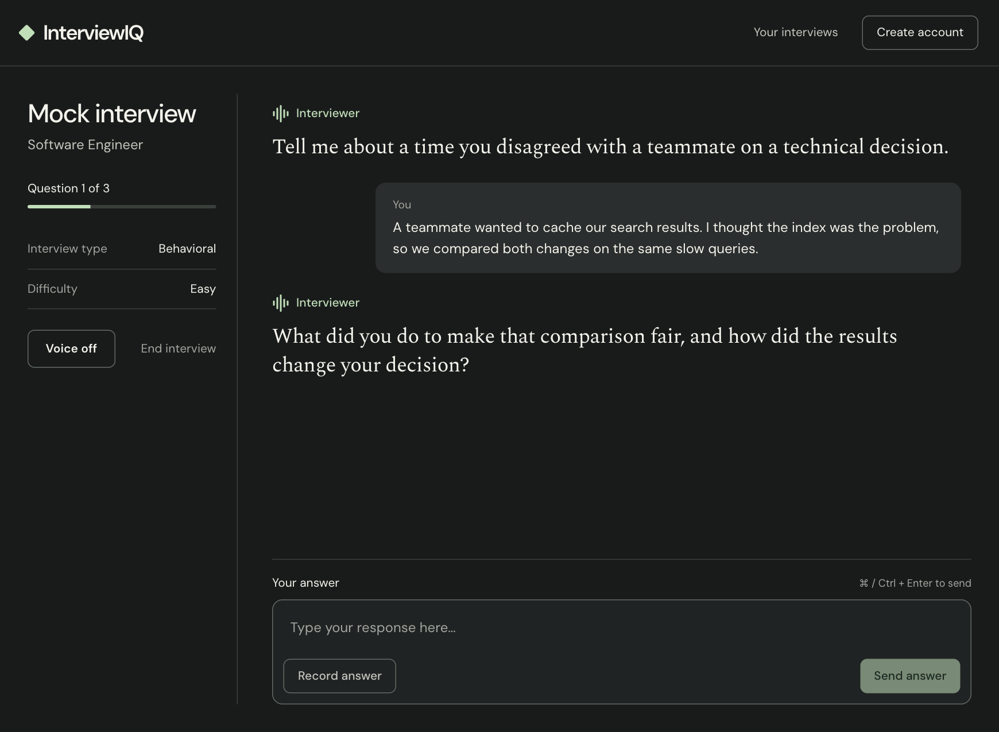

# InterviewIQ

InterviewIQ turns a job description into behavioral and coding practice that picks up where you left off. When you come back, the interviewer uses your past questions, feedback, and skill scores to decide what to ask next. A session can move from writing code to explaining a team decision, or focus on behavioral questions about conflict, failure, and growth.

| Behavioral practice | Coding practice |
| --- | --- |
|  |  |
| Tell the story out loud or in writing. If you say “we compared both approaches,” a follow-up can ask what **you** did to make the comparison fair and how the team decided. | Write Python or JavaScript in the CodeMirror editor and explain your approach. If you use a set to detect repeated requests, a follow-up can ask how much memory it needs as new IDs arrive. |

InterviewIQ also supports product and consulting interviews. [Interview tracks](src/lib/constants.ts) · [Coding workspace](src/components/CodingWorkspace.tsx) · [Architecture and API calls](#architecture-and-api-calls)

## What happens after you answer?

**During the interview**, the evaluator scores the skills your answer demonstrates. In a behavioral interview, it looks for a clear situation, task, action, and result (STAR), along with ownership and reflection. In a coding interview, it looks at skills such as problem solving, complexity analysis, and edge-case handling. After up to three answers, you get a transcript, a skill breakdown, and practice drills. [Skill rubrics](src/lib/constants.ts) · [Interview logic](src/lib/interviewer.ts)

## Long-term memory across interviews

Suppose you describe a disagreement with a teammate and explain the team's decision, but leave out your own contribution. That feedback carries into later interviews. On a different teamwork question, the interviewer can ask, “Which part did you own?” If past coding reports flag complexity analysis, a new problem can give you another chance to explain how runtime grows with input size.

**Supermemory** makes past feedback searchable. When enabled, it stores each session report with the questions asked, tagged to your user ID. At the start of a new interview, the app searches your reports for earlier weaknesses and questions. It gives those results to the interviewer to guide follow-ups and avoid repeating a prompt word for word. [Memory retrieval](src/lib/adaptation.ts) · [Question generation](src/lib/prompts.ts)

**SQLite** keeps your progress across sessions even when Supermemory is disabled. The app builds a skill profile from your scored interviews and uses your two lowest-rated skills to focus practice. If your overall session score falls below 7.5/10, you revisit the category with a simpler prompt. At 7.5 or higher, the app picks an unfinished category if one remains. [Saved reports](src/lib/store.ts) · [Session setup](src/app/api/sessions/route.ts)

## Architecture and API calls

The React client sends code, approach notes, and transcribed speech through the same answer endpoint. For coding questions, it loads CodeMirror on demand, turns a generated function signature into Python or JavaScript starter code, and keeps a separate draft for each language. On the server, Next.js route handlers own the transcript, interview phase, scoring, and calls to external services. [Session UI](src/app/session/%5Bid%5D/page.tsx) · [Editor implementation](src/components/CodingWorkspace.tsx)

| Step | API route | What happens on the server |
| --- | --- | --- |
| Start | `POST /api/sessions` | Classifies the job description by interview type and difficulty. Loads the skill profile, past feedback, and previous questions in parallel, then generates the opening question and saves the session. [Session creation](src/app/api/sessions/route.ts) |
| Answer | `POST /api/sessions/[id]/answer` | Requests JSON containing skill scores, evidence from the answer, and a follow-up decision. Server logic uses that decision and the turn count to stay on the topic, advance the phase, or close the interview. [Answer handler](src/app/api/sessions/%5Bid%5D/answer/route.ts) |
| Finish | `POST /api/sessions/[id]/end` | Generates the report from the transcript and score evidence. A single conditional SQLite update saves the report, session status, and any category result. Subsequent requests return the saved report. [Report generation](src/app/api/sessions/%5Bid%5D/end/route.ts) |

A full three-answer session uses **eight chat completions** on the successful path. One classifies the role, three generate interviewer questions, three evaluate answers, and one writes the report. The same OpenAI SDK client interface targets GPT-5.2 by default or Cerebras when configured. Voice and memory use separate APIs. [Model client](src/lib/openai.ts) · [Question generation and evaluation](src/lib/interviewer.ts)

<details>
<summary>Voice, memory, accounts, and the remaining API routes</summary>

| Feature | API calls and implementation |
| --- | --- |
| Voice input | Browser `MediaRecorder` captures WebM audio. `POST /api/transcribe` checks session ownership, sends the recording to OpenAI Whisper, and returns text the candidate can edit before submitting. [Recorder](src/hooks/useRecorder.ts) · [Transcription](src/app/api/transcribe/route.ts) |
| Spoken questions | `POST /api/tts` strips code blocks from the question, calls the ElevenLabs text-to-speech API, and returns MP3 audio for browser playback. [Speech synthesis](src/app/api/tts/route.ts) |
| Long-term memory | The server calls Supermemory’s `add` to store reports and skill profiles, `search.execute` to retrieve past feedback and questions by user ID, and `documents.uploadFile` for optional background audio uploads. [Supermemory calls](src/lib/adaptation.ts) |
| Accounts and history | `GET` and `POST /api/auth/[...all]` delegate authentication to Better Auth. The history page reads SQLite through an index on owner and creation time. `GET /api/sessions/[id]` restores a saved session and `GET /api/sessions/[id]/report` retrieves its report. [Auth handler](src/app/api/auth/%5B...all%5D/route.ts) · [Database schema](src/lib/database.ts) |
| Progress and reset | `GET /api/progress` calculates skill trends, completed categories, and repeated mistakes from saved results. `POST /api/reset` checks the request origin and requires explicit confirmation before clearing the current user’s practice history in SQLite. [Progress](src/app/api/progress/route.ts) · [Reset](src/app/api/reset/route.ts) |

</details>

## Engineering decisions

- **One rough session shouldn't define a skill.** Each skill starts at 5/10. A first score of 9 moves the estimate to 6. As observations accumulate, the app gives more weight to performance and less to that starting estimate. It keeps the latest ten scores per skill and weights each one by `0.7 ^ age`, so recent work counts more than older attempts. [Scoring implementation](src/lib/adaptation.ts)
- **Two browser tabs can answer the same question.** Evaluating an answer and generating a follow-up takes time. The server saves them together only if the SQLite session still matches the version it read. If another tab has already advanced the interview, the stale submission gets an HTTP 409 and the newer transcript stays intact. [SQLite write conditions](src/lib/store.ts)
- **Guest practice carries over at signup.** Better Auth gives a guest an anonymous user ID. When they create an account, the app transfers ownership of their interviews. They can resume a session or reopen its report from their history. [Account linking](src/lib/auth.ts)

## Run locally

Use **Node.js 24** to run the Next.js and TypeScript app. From the repository root, run `npm ci` and create a `.env.local` file with these values. Generate the auth secret once with `openssl rand -hex 32` and keep it across restarts.

```dotenv
OPENAI_API_KEY=<your OpenAI API key>
BETTER_AUTH_SECRET=<generated secret>
```

Run `npm run dev`, open [localhost:3000](http://localhost:3000), and choose **Practice as a guest**. Enter a job title and description to start.

<details>
<summary>Optional integrations and deployment</summary>

| Setting | Purpose |
| --- | --- |
| `CEREBRAS_API_KEY` | Routes interview generation and evaluation to Cerebras. Recorded answers still use OpenAI Whisper. |
| `ELEVENLABS_API_KEY` | Enables spoken interviewer questions. |
| `SUPERMEMORY_API_KEY` | Adds semantic retrieval of past questions and feedback. When enabled, the app also uploads recorded answers to Supermemory. |
| `BETTER_AUTH_URL` | Set this to the public HTTPS origin when hosting. |
| `INTERVIEWIQ_DB_PATH` | Defaults to `.data/interviewiq.sqlite`. For a single hosted instance, use a persistent volume and SQLite-aware backups. |

</details>
