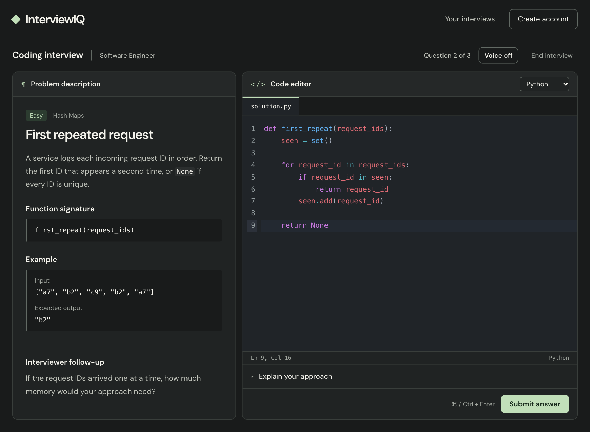

# InterviewIQ

InterviewIQ turns a job description into a short mock interview and uses the results to plan your next one. For a software engineering role, you can write a solution in Python or JavaScript, talk through the tradeoffs, and get a follow-up about the code you just submitted.

[Watch the demo](https://www.youtube.com/watch?v=m1hzI1Zs6l4) · [Try the hosted prototype](https://interviewiq-sage.vercel.app/)



*A sample session in the current build. The Next.js and TypeScript app uses CodeMirror for coding interviews and a voice or text conversation for product, consulting, and behavioral interviews.* [Coding workspace](src/components/CodingWorkspace.tsx)

## What happens after you answer?

**During the interview**, the evaluator scores the skills your answer demonstrates. If you solve a hash-map problem but leave the space complexity unexplained, the interviewer can stay on that problem and ask how much memory your solution needs. A session runs for up to three answers. At the end, you get a transcript, a skill breakdown, and drills for your next practice session. [Interview logic](src/lib/interviewer.ts) · [Evaluation criteria](src/lib/prompts.ts)

**Between interviews**, the app makes two decisions. The overall session score determines the next topic. Finish a hash-map interview with a 7/10 and the next one revisits hash maps with a simpler prompt. Score 7.5 or higher and the app picks an unfinished category if one remains. Separately, the app tracks individual skills to choose difficulty and what to probe. [Category and skill selection](src/lib/adaptation.ts)

## Engineering decisions

- **One rough session shouldn't define a skill.** Each skill starts at 5/10. A first score of 9 moves the estimate to 6. As observations accumulate, the app gives more weight to performance and less to that starting estimate. It keeps the latest ten scores per skill and weights each one by `0.7 ^ age`, so recent work counts more than older attempts. [Scoring implementation](src/lib/adaptation.ts)
- **Two browser tabs can answer the same question.** Evaluating an answer and generating a follow-up takes time. The server saves them together only if the SQLite session still matches the version it read. If another tab has already advanced the interview, the stale submission gets an HTTP 409 and the newer transcript stays intact. [SQLite write conditions](src/lib/store.ts)
- **Guest practice carries over at signup.** Better Auth gives a guest an anonymous user ID. When they create an account, the app transfers ownership of their interviews. They can resume a session or reopen its report from their history. [Account linking](src/lib/auth.ts)

## Run locally

Use **Node.js 24**. From the repository root, run `npm ci` and create a `.env.local` file with these values. Generate the auth secret once with `openssl rand -hex 32` and keep it across restarts.

```dotenv
OPENAI_API_KEY=<your OpenAI API key>
BETTER_AUTH_SECRET=<generated secret>
```

Run `npm run dev`, open [localhost:3000](http://localhost:3000), and choose **Practice as a guest**. Enter a job title and description to start.

<details>
<summary>Optional integrations and deployment</summary>

| Setting | Purpose |
| --- | --- |
| `CEREBRAS_API_KEY` | Routes interview generation and evaluation to Cerebras. Recorded answers still use OpenAI Whisper. |
| `ELEVENLABS_API_KEY` | Enables spoken interviewer questions. |
| `SUPERMEMORY_API_KEY` | Adds semantic retrieval of past questions and feedback. When enabled, the app also uploads recorded answers to Supermemory. |
| `BETTER_AUTH_URL` | Set this to the public HTTPS origin when hosting. |
| `INTERVIEWIQ_DB_PATH` | Defaults to `.data/interviewiq.sqlite`. For a single hosted instance, use a persistent volume and SQLite-aware backups. |

</details>
